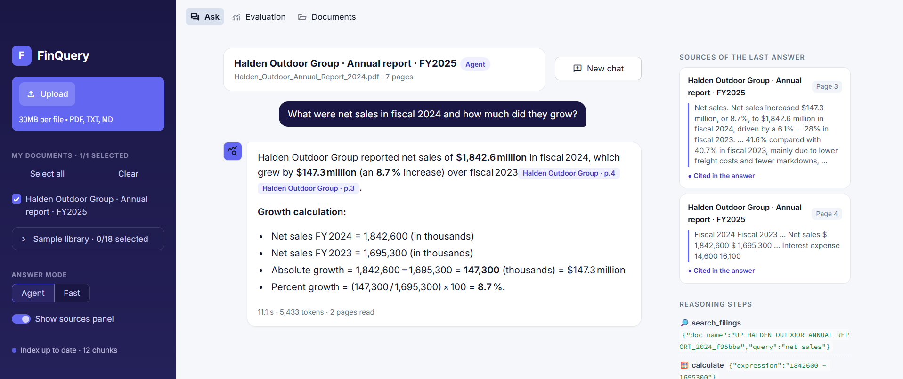
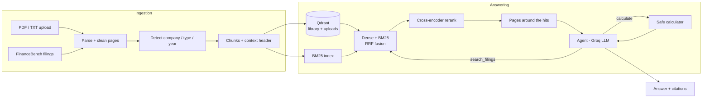
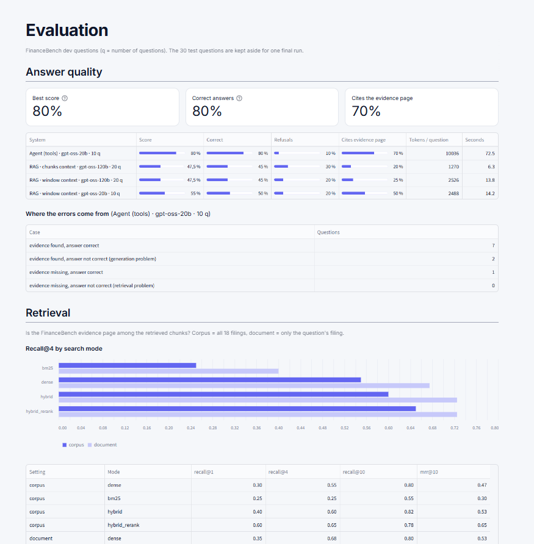

# FinQuery

[](https://github.com/EyaNajlaoui/finquery/actions/workflows/ci.yml)

**Upload a financial report, ask questions, get answers where every number cites its source page.**

FinQuery is a retrieval-augmented generation (RAG) application for annual reports, 10-K / 10-Q / 8-K
filings and earnings releases. It combines hybrid search (embeddings + BM25 + reranking) with a
tool-calling agent that searches several times and computes ratios with a safe calculator instead of
letting the LLM do arithmetic. When the documents do not contain the answer, it says so.

Every design choice is measured on a public benchmark, [FinanceBench](https://github.com/patronus-ai/financebench),
with a fixed dev/test split.



## Key results (dev set)

| What was measured | Baseline | FinQuery | |
|---|---:|---:|---|
| Evidence page ranked **first** (retrieval, 20 questions) | 0.30 dense search | **0.60** hybrid + rerank | ×2 |
| Correct answers (10 questions, same LLM `gpt-oss-20b`) | 0.50 one search + answer | **0.80** agent with tools | +3 questions |
| Questions where the evidence reached the LLM | 0.70 | **0.90** | |
| Numbers matching the analyst's answer (computed metrics) | 0.67 | **1.00** | |

The agent costs more: ~10,000 prompt tokens and ~70 s per question, against ~2,500 tokens and ~14 s.
Small samples: one question = 0.05 on 20 questions, 0.10 on 10. On the 30 held-out test questions the
retrieval gain does **not** hold (reranked hybrid and dense search both rank the evidence first for 0.30 of
the questions): see [Results](#results).

## Features

- **Upload any financial document** (PDF with text, TXT, MD): parsed, cleaned, chunked and indexed in about
  a minute. A small LLM detects the company, document type and fiscal year from the first pages.
- **Choose what to search**: tick any combination of your documents and of the sample library
  (18 SEC filings from 13 companies, FinanceBench); every search stays inside the selection.
- **Two answer modes**: *Fast* (one hybrid search, one answer) and *Agent* (plans several searches, uses a
  calculator, stays inside the documents the user selected).
- **Cited answers**: each number is followed by a `[document · page]` badge; a citation to a page the model
  never received is flagged in red. Sources and the agent's reasoning steps can be opened under each answer.
- **Evaluation page** in the app: answer quality per system, error diagnosis, retrieval metrics.
- **Sources panel**: for the last answer, every page the model read, with the lines holding the numbers it used.

## Architecture



## How it works

### 1. Ingestion
| Choice | Reason |
|---|---|
| `pdfplumber.extract_text` for text **and** tables | keeps each table row on one line (`Total current assets 29,505 28,120`); separate table extraction duplicated numbers and lost the year headers |
| Repeated header/footer lines removed (page numbers, "Table of Contents") | only in the first/last 2 lines of a page, so table rows are never dropped |
| Chunks never cross a page, split on line boundaries | each chunk cites one exact page; a table row is never cut |
| Context header on every chunk: `Costco \| 10-K \| FY2021 \| page 38 \| ... CONSOLIDATED BALANCE SHEETS` | a chunk holding only numbers is meaningless without company, year and statement |
| Full page text kept next to the chunks | small chunks for search, the surrounding page for the LLM (small-to-big) |

Check on the 23 evidence passages of the dev set (`python scripts/check_ingestion.py`): **100%** of the
evidence text is found in the parsed pages, **89%** inside a single chunk of 150 words.

### 2. Indexing
| Choice | Reason |
|---|---|
| Embeddings `bge-small-en-v1.5`, query instruction on queries only | the model is trained this way; passages are encoded as-is |
| Token count checked before indexing | text above the 512-token limit would be silently cut (3 chunks out of 5,373) |
| Qdrant point id = UUID of `chunk_id`, `content_hash` in the payload | re-running only embeds new or changed chunks and deletes removed ones |
| Uploads in a separate Qdrant collection | user documents never change the benchmark results |
| Filters on `company`, `doc_type`, `doc_period`, `doc_name` | searches stay inside the selected documents |

### 3. Retrieval
A question counts as found when a retrieved chunk comes from its FinanceBench evidence page.
**Corpus** = search all 18 filings, **document** = only the question's filing. 20 dev questions.

| Mode | Corpus R@1 | Corpus R@4 | Corpus MRR@10 | Document R@4 | Document MRR@10 |
|---|---:|---:|---:|---:|---:|
| Dense (bge-small) | 0.30 | 0.55 | 0.47 | 0.68 | 0.53 |
| BM25 | 0.25 | 0.25 | 0.30 | 0.40 | 0.38 |
| Hybrid (RRF) | 0.40 | 0.60 | 0.53 | 0.72 | 0.62 |
| **Hybrid + rerank** | **0.60** | **0.65** | **0.65** | **0.72** | **0.65** |

- Each stage helps; reranking mostly moves the evidence to the top.
- BM25 alone is weak on long natural-language questions but adds chunks the dense search misses.
- The small corpus/document gap shows the context header lets the search find the right filing.
- The misses share one cause: the question names a **computed metric** (quick ratio, EBITDA margin,
  "topline performance") while the page only holds its ingredients. This is what the agent addresses.

**Chunk size** (hybrid + rerank, Recall@4 / MRR@10):

| Words / overlap | Chunks | Over 512 tokens | Corpus | Document |
|---|---:|---:|---:|---:|
| **150 / 30** | 5,373 | 3 | 0.65 / **0.65** | 0.72 / **0.65** |
| 250 / 50 | 3,332 | 44 | 0.70 / 0.60 | 0.70 / 0.58 |
| 400 / 80 | 2,236 | 646 | 0.65 / 0.55 | 0.75 / 0.59 |

Recall@4 differences are within one question; MRR is best at 150 words in both settings, with almost no
truncation and 2.5× less text sent to the LLM. 150 / 30 is kept.

### 4. Grounded generation
- The LLM receives each retrieved chunk **with its neighbours on the same page** (one passage per page,
  4 different pages): a balance sheet split over 3 chunks is put back together with its column headers.
- Prompt rules: facts only from the extracts, a citation after every number, check year and unit,
  formula + inputs for calculations, a fixed refusal sentence when information is missing.
- Two fixes came from reading the dev errors: the model wrote citations as `【...】` (now parsed too), and
  3 refusals came from fiscal-year labels (Ulta's "fiscal 2022" ends in January 2023 = FY2023).

### 5. Agent
- Tools: `search_filings(query, doc_name?)` (the full hybrid + rerank pipeline) and `calculate(expression)`
  (arithmetic parsed with `ast`, no Python code can run).
- The list of available documents is in the prompt, so the agent picks the right filing itself.
- Guardrails: at most 6 turns, tool errors returned as text so the model can correct itself, a text budget
  per search and per question (tool outputs are re-sent at every turn; without it a request exceeded the
  API's 8,000 tokens-per-minute limit), citations checked against every page the tools returned.

## Answer evaluation

Correctness is graded by an LLM judge against the FinanceBench analyst answer (correct / partial /
incorrect); everything that can be checked exactly is checked by code: numbers (1% tolerance), citations,
whether the evidence page reached the LLM. The judge is a different model from the one answering
(less self-preference, separate API quota).



**RAG vs agent** — first 10 dev questions, same model (`openai/gpt-oss-20b`), corpus setting:

| | RAG (one search) | Agent (tools) |
|---|---:|---:|
| Correct | 0.50 | **0.80** |
| Score (partial = 0.5) | 0.55 | **0.80** |
| Evidence reached the LLM | 0.70 | **0.90** |
| Cites the evidence page | 0.50 | **0.70** |
| Refusals | 0.20 | 0.10 |
| Errors from retrieval / from generation | 3 / 2 | **0 / 2** |
| Prompt tokens per question | 2,488 | 10,036 |
| Seconds per question | 14 | 72 |

The agent fixed all three retrieval failures (quick ratio, cash flow sources, EBITDA margin) by searching
each ingredient separately. The two remaining errors are about interpretation: a quick-ratio definition
different from the analyst's (0.53 vs 0.67), and "wages" reported by the company as "store payroll and
benefits".

## Engineering for real use

| Concern | What FinQuery does |
|---|---|
| API rate limits | per-minute limits retried by the SDK; daily limits switch the app to a fallback model; evaluations never mix models and stop cleanly, resuming where they stopped |
| Reproducible evaluation | answers and grades cached with a signature of the prompts and settings: a prompt change regenerates exactly what it affects |
| Unexpected model output | JSON mode failures retried in normal mode; unparsable grades recorded, never crashing a run |
| Monitoring | every question and upload logged to `data/logs/queries.jsonl` (latency, tokens, refusals, invalid citations) |
| Safety | the calculator cannot run code; the model's text is HTML-escaped before display; API key only in `.env` |
| Isolation | uploads in their own folder and Qdrant collection, never mixed with the benchmark |
| Quality gates | 79 unit tests (no model download, Qdrant in memory) and ruff on every push (GitHub Actions) |
| Deployment | Docker image (CPU PyTorch) + Qdrant server with Docker Compose |

## Quickstart

Requirements: Python 3.10+ and a free [Groq API key](https://console.groq.com/keys). Docker is optional.

### Local

```bash
git clone https://github.com/EyaNajlaoui/finquery.git
cd finquery
python -m venv .venv
# Windows: .venv\Scripts\activate     macOS/Linux: source .venv/bin/activate
pip install -r requirements.txt -r requirements-dev.txt
pip install -e .
cp .env.example .env               # Windows: copy .env.example .env   then add your GROQ_API_KEY

# Sample library (optional for your own documents, needed for the evaluation)
python scripts/download_data.py    # 18 PDFs (~17 MB) + dev/test questions
python scripts/ingest.py           # parse + chunk (~5 min the first time, then cached)
python scripts/build_index.py      # embeddings -> Qdrant (~10 min on CPU, incremental)

streamlit run app/Home.py          # http://localhost:8501
```

### Docker

```bash
cp .env.example .env               # add your GROQ_API_KEY
docker compose up --build          # app on http://localhost:8501, Qdrant on http://localhost:6333
docker compose run --rm app python scripts/build_index.py   # index the sample library in the Qdrant server
```

### Command line

```bash
python scripts/ask.py "What were Costco's total assets at the end of FY2021?"
python scripts/ask.py "Has AMCOR's quick ratio improved or declined between FY2023 and FY2022?" --agent
python scripts/eval_retrieval.py                       # Recall@k / MRR, dev set
python scripts/eval_generation.py --system agent       # answer quality, dev set
pytest && ruff check .
```

## Project structure

```
finquery/
├── app/                      # Streamlit: Home.py (navigation), views/ (Ask, Evaluation, Documents), ui.py
├── config/settings.yaml      # every parameter (models, chunk size, top-k, agent budget...)
├── data/
│   ├── eval/                 # dev.jsonl, test.jsonl (FinanceBench subset)
│   ├── documents.jsonl       # sample library metadata
│   └── raw/ processed/ uploads/ qdrant/ logs/   # generated, not in git
├── docs/images/              # screenshots
├── results/                  # evaluation outputs (JSON), committed
├── scripts/                  # download, ingest, index, search, ask, evaluations, experiments
├── src/finquery/
│   ├── ingestion/            # parser, chunker, metadata detection, uploads
│   ├── retrieval/            # embedder, Qdrant, BM25, RRF, reranker, retriever
│   ├── generation/           # context building, prompts, Groq client, answerer, pipeline
│   ├── agent/                # tool-calling agent
│   ├── tools/                # safe calculator
│   ├── evaluation/           # retrieval and answer metrics, LLM judge
│   └── data/                 # FinanceBench loading and dev/test split
├── tests/                    # 79 tests
├── Dockerfile, docker-compose.yml
└── .github/workflows/ci.yml
```

## Roadmap

- [x] **Step 0 – Foundations**: structure, config, data download and split, Docker, tests, CI
- [x] **Step 1 – Ingestion**: PDF parsing, cleaning, chunking with metadata
- [x] **Step 2 – Indexing**: embeddings in Qdrant, BM25 index
- [x] **Step 3 – Retrieval evaluation**: dense vs BM25 vs hybrid vs rerank, chunk size
- [x] **Step 4 – Generation**: grounded answers with citations, refusal, LLM judge, error diagnosis
- [x] **Step 5 – Agent**: search + calculator tools, guardrails, traces
- [x] **Step 6 – Streamlit app**: document upload, cited answers, sources, evaluation page
- [x] **Step 7 – Production**: rate-limit handling, caching, logging, Docker
- [ ] **Step 8 – Final evaluation**: one run on the 30 test questions

## Limitations

- Small evaluation sets (20 dev, 30 test questions): results are indications, not proof.
- One LLM judge; its grades were spot-checked by reading answers, not validated against a human panel.
- Scanned PDFs (images) need OCR, which FinQuery does not do. Quality on uploaded documents is not measured.
- Groq free tier: daily token limits make large evaluations of the agent span several days.

## Results

Held-out test set (30 FinanceBench questions), run once with the configuration frozen on the dev set.

**Retrieval** (`python scripts/eval_retrieval.py --split test`):

| Mode | Corpus R@1 | Corpus R@4 | Corpus MRR@10 | Document R@4 | Document R@10 |
|---|---:|---:|---:|---:|---:|
| Dense (bge-small) | 0.30 | **0.50** | 0.40 | **0.62** | 0.72 |
| BM25 | 0.10 | 0.20 | 0.16 | 0.33 | 0.52 |
| Hybrid (RRF) | 0.17 | 0.45 | 0.32 | 0.55 | 0.65 |
| Hybrid + rerank (chosen on dev) | 0.30 | 0.42 | 0.40 | 0.52 | **0.78** |

The test set does **not** confirm the dev ranking: reranked hybrid search was the best mode on the 20 dev
questions (R@4 0.65) but dense search alone is better on the 30 test questions (0.50 vs 0.42). With 20
questions, the dev set was too small to separate the methods reliably; 8 test questions are not found by
any mode in the corpus setting. The configuration was not changed after seeing these numbers.

**Answers** (agent, `gpt-oss-20b`, stratified sample of 15 test questions chosen by rule, seed 42):
*in progress — the free API quota limits the run to a few questions per day.* On the first 11 test
questions completed so far, 9 answers are correct, several of them for questions where the first searches
missed the evidence page: the agent searches again until it finds the figures.

## Disclaimer

FinQuery is an educational and analysis tool. Its answers can be wrong and are **not investment advice**.

## License

Code: [MIT](LICENSE). Evaluation data derived from FinanceBench is under
[CC BY-NC 4.0](https://creativecommons.org/licenses/by-nc/4.0/).
