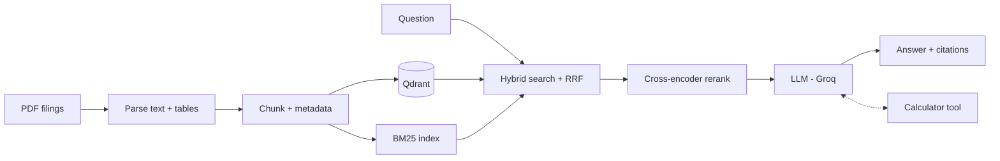

# FinQuery

**Ask questions about financial filings and get answers grounded in the source pages.**

FinQuery is a retrieval-augmented generation (RAG) system for 10-K, 10-Q, 8-K and earnings releases.
You load the filings, ask a question in plain English ("What was Boeing's gross margin in FY2022?"),
and FinQuery answers with citations to the exact document and page, computes ratios with a safe calculator
instead of letting the LLM do arithmetic, and says so when the documents do not contain the answer.

Every design choice is measured on a public benchmark (FinanceBench) with a fixed dev/test split.

> **Status: step 3 – retrieval evaluated.** 18 filings, 5,373 chunks, hybrid search (Qdrant + BM25, RRF)
> with cross-encoder reranking. On the 20 dev questions, reranked hybrid search finds the evidence page
> in first position for 60% of the questions, against 30% for dense search alone.
> See the [roadmap](#roadmap) for what comes next.

## Planned features

- **Ingestion** of PDF filings: text and tables (tables linearized row by row), page-level metadata
  (company, document type, period, page).
- **Hybrid retrieval**: dense embeddings (`bge-small-en-v1.5`) + BM25, fused with Reciprocal Rank Fusion,
  then reranked with a cross-encoder. Stored in **Qdrant** with metadata filters.
- **Grounded answers** with `[document, page]` citations and an explicit refusal when the evidence is missing.
- **Agent mode**: the LLM can search several times, filter by company/year and call a calculator tool
  for ratios and growth rates.
- **Evaluation**: Recall@k and MRR on evidence pages, numeric correctness checked by code, and an
  LLM judge for correctness and faithfulness, all reported on a held-out test set.
- **Streamlit interface**: chat, filters by company / document type / period, sources shown with each answer.

## Architecture



## Tech stack

| Layer | Choice | Why |
|---|---|---|
| Interface | Streamlit | fast to build, easy to demo |
| Vector store | Qdrant (local mode in dev, server in Docker) | payload filters, same API from laptop to production |
| Embeddings | `BAAI/bge-small-en-v1.5` | strong English retrieval, runs on CPU |
| Lexical search | `rank-bm25` | exact matches on tickers, line items and numbers |
| Reranker | `cross-encoder/ms-marco-MiniLM-L-6-v2` | better ordering of the top candidates, CPU friendly |
| LLM | `openai/gpt-oss-120b` via Groq | tool calling, fast inference |
| PDF parsing | `pdfplumber`, `pypdf` | text and table extraction |
| Packaging | Docker, Docker Compose | one command to run app + database |
| Quality | pytest, ruff, GitHub Actions | tests and lint on every push |

All parameters (models, chunk size, top-k...) live in [`config/settings.yaml`](config/settings.yaml).

## Data

50 questions from [FinanceBench](https://github.com/patronus-ai/financebench) over 18 filings from
13 companies (1,242 pages), split into **20 dev** and **30 test** questions stratified by question type.
Details, selection table and file format: [`data/README.md`](data/README.md).

## Quickstart

Requirements: Python 3.10+ and a free [Groq API key](https://console.groq.com/keys).
Docker is optional.

### Local

```bash
git clone https://github.com/<your-username>/finquery.git
cd finquery
python -m venv .venv
# Windows: .venv\Scripts\activate     macOS/Linux: source .venv/bin/activate
pip install -r requirements.txt -r requirements-dev.txt
pip install -e .

cp .env.example .env             # Windows: copy .env.example .env   then add your GROQ_API_KEY
python scripts/download_data.py  # 18 PDFs (~17 MB) + dev/test files
python scripts/ingest.py         # parse + chunk (~5 min the first time, then cached)
python scripts/build_index.py    # embeddings -> Qdrant (incremental)
python scripts/search.py "What were Costco's total assets in FY2021?" --company Costco
python scripts/eval_retrieval.py # Recall@k / MRR on the dev set -> results/
streamlit run app/Home.py        # http://localhost:8501
```

### Docker

```bash
cp .env.example .env             # add your GROQ_API_KEY
docker compose up --build        # app on http://localhost:8501, Qdrant on http://localhost:6333
```

The `data/` folder is mounted into the container, so the downloaded PDFs and the index are shared
with the local setup. Downloaded models are cached in a Docker volume.

### Tests

```bash
pytest
ruff check .
```

## Project structure

```
finquery/
├── app/                    # Streamlit interface
│   ├── Home.py
│   └── pages/
├── config/settings.yaml    # all parameters
├── data/
│   ├── raw/                # PDFs (downloaded, not in git)
│   └── eval/               # dev.jsonl, test.jsonl
├── scripts/                # command-line entry points
│   ├── download_data.py
│   ├── ingest.py           # PDFs -> data/processed/chunks.jsonl
│   ├── check_ingestion.py  # is the evidence still there after parsing/chunking?
│   ├── build_index.py      # chunks -> embeddings -> Qdrant
│   ├── search.py           # dense vs BM25 results for one question
│   ├── eval_retrieval.py   # Recall@k / MRR of the 4 search modes
│   └── experiment_chunk_size.py  # chunk size comparison (in memory)
├── src/finquery/
│   ├── config.py           # settings loading + env overrides
│   ├── data/               # FinanceBench loading, normalization, split
│   ├── ingestion/          # parsing, cleaning, chunking (step 1)
│   ├── retrieval/          # dense, BM25, fusion, rerank (steps 2-3)
│   ├── generation/         # prompts, grounded answers (step 4)
│   ├── agent/              # tool-calling agent (step 5)
│   ├── tools/              # safe calculator
│   ├── sql/                # SQL safety checks (optional structured data)
│   └── evaluation/         # retrieval + answer metrics
├── results/                # evaluation outputs (JSON), committed
├── tests/
├── Dockerfile
├── docker-compose.yml
└── .github/workflows/ci.yml
```

## Roadmap

- [x] **Step 0 – Foundations**: structure, config, data download and split, Docker, tests, CI
- [x] **Step 1 – Ingestion**: PDF parsing (text + tables), chunking, metadata
- [x] **Step 2 – Indexing**: embeddings in Qdrant, BM25 index
- [x] **Step 3 – Retrieval evaluation**: Recall@k / MRR on evidence pages, dense vs hybrid vs rerank
- [ ] **Step 4 – Generation**: grounded answers with citations, refusal, LLM judge
- [ ] **Step 5 – Agent**: multi-step search + calculator tool, traces
- [ ] **Step 6 – Streamlit app**: chat, filters, sources, upload of new filings
- [ ] **Step 7 – Production**: logging, caching, error handling, Docker image hardening
- [ ] **Step 8 – Final evaluation**: one run on the test set, results table in this README

## Ingestion

| Choice | Reason |
|---|---|
| `pdfplumber.extract_text` for text **and** tables | keeps each table row on one line (`Total current assets 29,505 28,120`); separate table extraction duplicated numbers and lost the year headers |
| Repeated header/footer lines removed (page numbers, "Table of Contents") | only in the first/last 2 lines of a page, so table rows are never dropped |
| Chunks never cross a page, split on line boundaries | each chunk cites one exact page; a table row is never cut |
| Context header on every chunk: `Costco \| 10-K \| FY2021 \| page 38 \| ... CONSOLIDATED BALANCE SHEETS` | a chunk holding only numbers is meaningless without company, year and statement |
| Full page text kept next to the chunks | small chunks for search, whole page for the LLM (small-to-big) |

Check on the 23 evidence passages of the dev set (`python scripts/check_ingestion.py`):

| Chunk size (words / overlap) | Chunks | Evidence words found in the page | in the best chunk |
|---|---:|---:|---:|
| 100 / 20 | 7,583 | 100% | 80% |
| **150 / 30 (current)** | **5,373** | **100%** | **89%** |
| 250 / 50 | 3,332 | 100% | 95% |
| 400 / 80 | 2,236 | 100% | 99% |

Bigger chunks hold more of the evidence but make search less precise. The size was then chosen in step 3
on retrieval metrics: see [Retrieval evaluation](#retrieval-evaluation).

## Indexing

| Choice | Reason |
|---|---|
| Embeddings `bge-small-en-v1.5`, query instruction on queries only | the model is trained this way; passages are encoded as-is |
| Token count checked before indexing | text above the 512-token limit would be silently cut |
| Qdrant point id = UUID of `chunk_id`, `content_hash` in the payload | re-running only embeds new or changed chunks and deletes removed ones |
| Filters on `company`, `doc_type`, `doc_period`, `doc_name` | "Amazon 2017" questions only search Amazon's 2017 filing; payload indexes on the server |
| BM25 rebuilt in memory from `chunks.jsonl` | exact matches on numbers and line items; nothing extra to keep in sync |

## Retrieval evaluation

A question counts as found when a retrieved chunk comes from its FinanceBench evidence page.
Two settings: **corpus** (search all 18 filings) and **document** (search only the question's filing,
as when the user selects it). 20 dev questions, `python scripts/eval_retrieval.py`.

| Mode | Corpus R@1 | Corpus R@4 | Corpus MRR@10 | Document R@4 | Document MRR@10 |
|---|---:|---:|---:|---:|---:|
| Dense (bge-small) | 0.30 | 0.55 | 0.47 | 0.68 | 0.53 |
| BM25 | 0.25 | 0.25 | 0.30 | 0.40 | 0.38 |
| Hybrid (RRF) | 0.40 | 0.60 | 0.53 | 0.72 | 0.62 |
| **Hybrid + rerank** | **0.60** | **0.65** | **0.65** | **0.72** | **0.65** |

- Each stage helps; reranking mostly moves the evidence to the top (R@1 0.30 → 0.60).
- BM25 alone is weak on long natural-language questions but adds chunks the dense search misses.
- Corpus vs document gap is small: the context header (company, year) lets the search find the right filing.
- The misses share one cause: the question names a **computed metric** (quick ratio, EBITDA margin,
  "topline performance") while the page only holds its ingredients (cash, receivables, revenue...).
  This is addressed by query rewriting and the agent (steps 4-5).

**Chunk size** (`python scripts/experiment_chunk_size.py`, hybrid + rerank, Recall@4 / MRR@10):

| Words / overlap | Chunks | Over 512 tokens | Corpus | Document |
|---|---:|---:|---:|---:|
| **150 / 30** | 5,373 | 3 | 0.65 / **0.65** | 0.72 / **0.65** |
| 250 / 50 | 3,332 | 44 | 0.70 / 0.60 | 0.70 / 0.58 |
| 400 / 80 | 2,236 | 646 | 0.65 / 0.55 | 0.75 / 0.59 |

Recall@4 differences are within one question (0.05) on 20 questions, while MRR is best at 150 words in
both settings. 150 / 30 is kept: best ranking, almost no truncation, and 4 × 150 words sent to the LLM
instead of 4 × 400. With 20 questions these are indications, not proof; the test set is used only once.

## Results

Will be filled in at step 8 with the scores on the 30 test questions.

## Disclaimer

FinQuery is an educational and analysis tool. Its answers can be wrong and are **not investment advice**.

## License

Code: [MIT](LICENSE). Evaluation data derived from FinanceBench is under
[CC BY-NC 4.0](https://creativecommons.org/licenses/by-nc/4.0/).